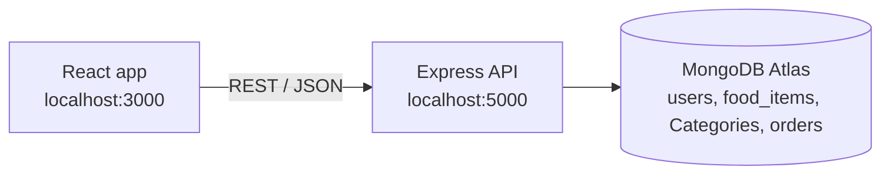

# SwadHub

A full-stack food ordering web app built with the MERN stack (MongoDB, Express, React, Node.js).
Users sign up, browse dishes by category, add items to a cart, place orders and see their order history.

> Learning project from 2023, built while learning full-stack JavaScript. It is not maintained.

## Features

- Sign up and log in with hashed passwords (bcrypt) and JWT-based sessions
- Input validation on the API with `express-validator`
- Menu loaded from MongoDB, grouped by food category, with search
- Cart managed with React Context and `useReducer`
- Order placement and "My Orders" history stored per user
- Location lookup from coordinates during sign-up

## Architecture



## API

| Method | Route | Purpose |
|---|---|---|
| POST | `/api/auth/createuser` | Register a user (password hashed with bcrypt) |
| POST | `/api/auth/login` | Log in and receive a JWT |
| POST | `/api/auth/getuser` | Get the current user (JWT required) |
| POST | `/api/auth/getlocation` | Resolve an address from coordinates |
| POST | `/api/auth/foodData` | Menu items and categories |
| POST | `/api/auth/orderData` | Save an order |
| POST | `/api/auth/myOrderData` | A user's order history |

## Running locally

```bash
# backend
cd backend
cp .env.example .env      # add your MongoDB URI and a JWT secret
npm install
node index.js

# frontend (new terminal, repo root)
npm install
npm start
```

## Tech stack

React 18, React Router, React Bootstrap, Node.js, Express, Mongoose, MongoDB Atlas, bcryptjs, JSON Web Tokens.
